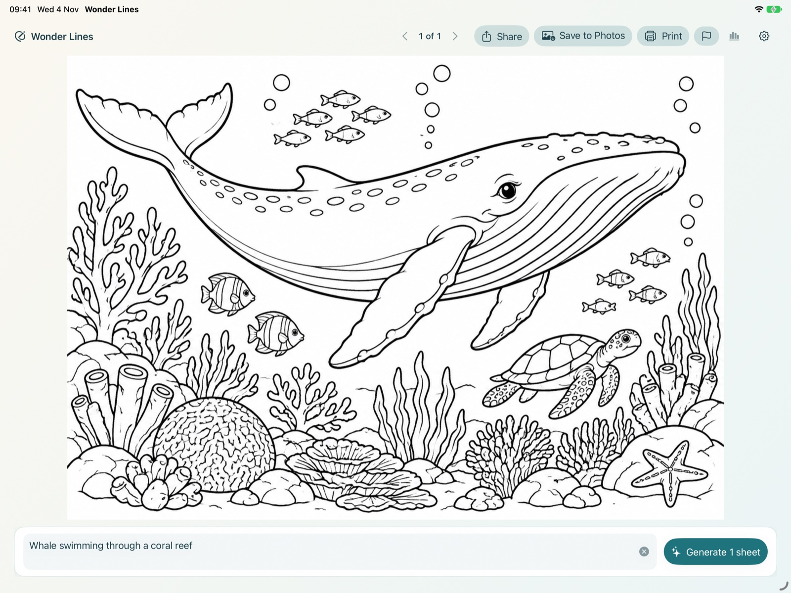

# WonderLines

Turn an idea into coloring sheets for iPhone and iPad. Describe a scene, choose the drawing detail, then save, share, or print your favorite sheet.

Created by Jordan Erenrich. Built with SwiftUI for iOS and iPadOS 17 and later.

[Project website](https://jerenrich.github.io/WonderLines/) · [Privacy policy](https://jerenrich.github.io/WonderLines/privacy.html)

*A Wonder Lines-generated page shown in the current iPad interface.*

## What it does

- Creates 1–3 sheets from a description, with a choice of image models.
- Offers Simple, Balanced, Detailed and Intricate drawing detail, from larger shapes and open spaces to finer outlines and detailed backgrounds.
- Lets you swipe through results and save, share, or print A4 landscape sheets.
- Pinch to zoom up to 5× and drag to explore details; double-tap to zoom in or return to the full sheet.
- Offers a “Surprise me” button that fills an editable starter idea.
- Keeps your draft and sheets for quick returns; starts fresh after 15 minutes away. Sheets still drawing when the app is interrupted are recovered automatically.
- Works on iPhone and iPad, with no sign-in required.

## Start with the demo

1. Clone this repository and open `ColoringSheets.xcodeproj` in Xcode.
2. Select the **ColoringSheets** scheme and an iPhone or iPad simulator.
3. Run in Debug with `COLORING_MODE = mock` (the checked-in default). If you already have local overrides, use the `--mock` launch argument.
4. Enter a description, choose Drawing detail in Settings, and tap **Make 3 demo sheets**.

The offline demo uses sample images and makes no network requests or paid generations.

## Enable live generation

Deploy and configure the [Cloudflare image service](workers/coloring-sheets-api/README.md), then copy `Config/Local.example.xcconfig` to `Config/Local.xcconfig`. Set `COLORING_MODE = live`, configure your service URL and signing team, and rebuild.

Live generation uses paid image providers. Credentials stay on the server; the app creates an anonymous service account automatically.

## Explore the project

- [Development guide](docs/development.md): app architecture, device setup, offline tests, and verification notes.
- [Image service](workers/coloring-sheets-api/README.md): API, deployment, providers, and recovery.
- [Coloring-sheet dataset](datasets/colouring-sheets/README.md): catalogue, previews, and publication tools.
- [Public dataset on Hugging Face](https://huggingface.co/datasets/jerenrich/wonderlines-colouring-sheets): 400 sheets across four age bands, licensed under CC BY 4.0.
- [App Store release records](docs/app-store/README.md): listing, screenshots, privacy declarations, and submission history.
